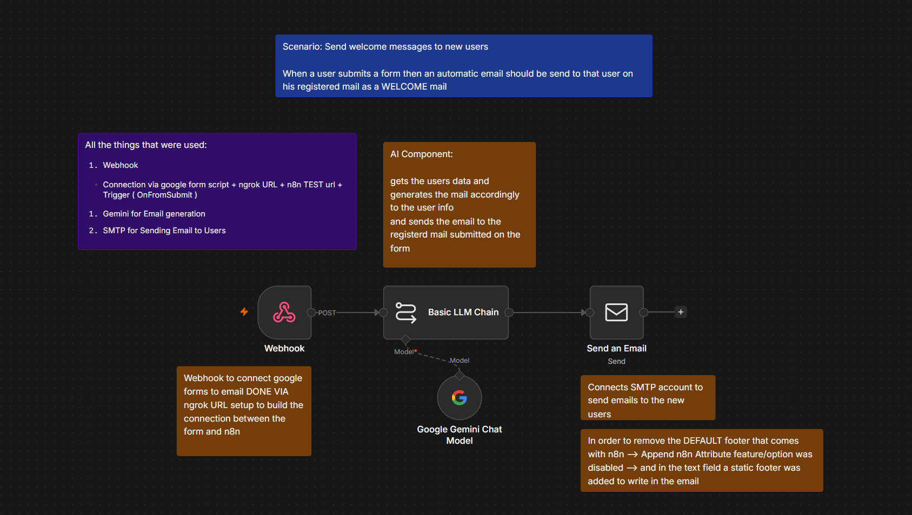

# Scenario 1: Auto Email Generation via Google Forms Data

An automated workflow that listens for Google Form submissions, enriches the data using Google Gemini (LLM), and sends an automated personalized welcome email to the user via SMTP.

---

## 🖼️ Workflow Architecture

---

## ⚙️ Nodes & Tools Used

- **Webhook Node:** Captures real-time form submission data via Google Apps Script (`onFormSubmit`) tunneled through Ngrok.
- **Basic LLM Chain (Google Gemini Chat Model):** Analyzes the submitted user data and drafts a personalized welcome email.
- **Send an Email Node (SMTP):** Sends the generated email to the recipient's address with a clean, custom footer.

---

## 🚀 How to Import into Your n8n

1. Download the [`workflow.json`](./workflow.json) file from this folder.
2. In your n8n canvas, click **`...`** (top right) ➔ **Import from File**.
3. Select `workflow.json`.
4. Configure your credentials:
   - Google Gemini API Key
   - SMTP / Email credentials
5. Connect your Google Form to the Webhook URL and test!
