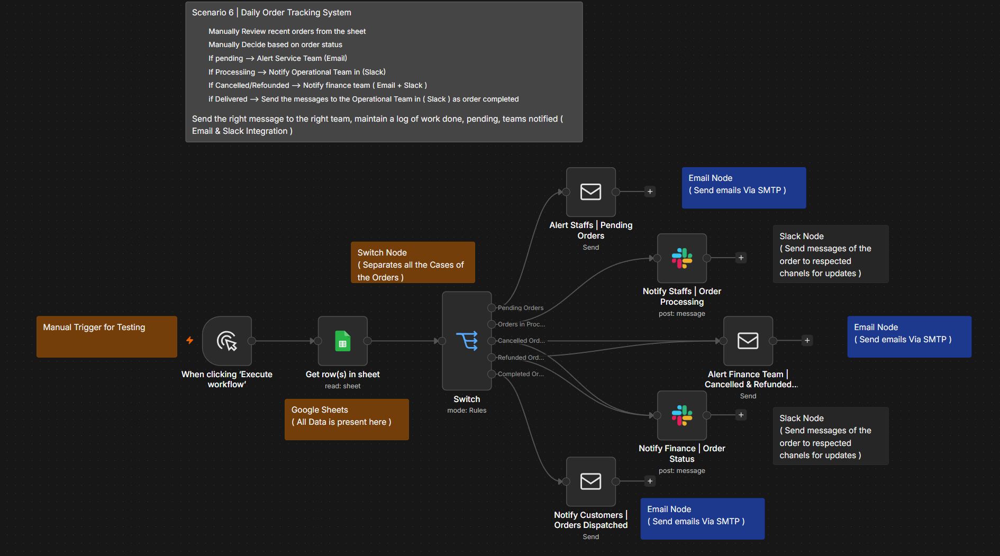

# Scenario 6: Daily Order Tracking & Multi-Channel Alert System

An automated multi-department routing workflow that reads daily order updates from Google Sheets, evaluates order statuses using rule-based logic, and dispatches targeted alerts across **Email (SMTP)** and **Slack** to the responsible teams.

---

## 🖼️ Workflow Architecture

---

## 🎯 The Business Problem

In an e-commerce operation, different teams handle different stages of an order:
- **Service Team** needs to know about stalled/pending orders.
- **Operations Team** needs real-time alerts for orders currently in processing.
- **Finance Team** must immediately review cancelled or refunded orders to issue payouts.
- **Customers** need dispatch confirmation once an order is complete.

Manually reading a spreadsheet and messaging each team wastes hours and leads to communication bottlenecks. This workflow automates that triage instantly.

---

## 🔀 Smart Routing Logic (The Switch Node)

| Order Status | Target Recipient | Channel | Action Taken |
| :--- | :--- | :--- | :--- |
| **Pending** | Customer Service Team | ✉️ **Email** | Alerts staff to resolve order roadblocks. |
| **Processing** | Operations Team | 💬 **Slack** | Notifies warehouse to prepare packing. |
| **Cancelled / Refunded** | Finance Team | ✉️ **Email** + 💬 **Slack** | Dual alert to stop shipment and process refunds. |
| **Completed / Delivered** | Customer | ✉️ **Email** | Sends delivery/dispatch confirmation. |

---

## ⚙️ Nodes & Tools Used

- **Manual Trigger:** Initiates the audit run on demand.
- **Google Sheets Node (`read: sheet`):** Reads the active orders log and retrieves order statuses.
- **Switch Node (`mode: Rules`):** Inspects the `Status` column and routes items down 5 separate condition paths.
- **Send an Email Node (SMTP):** Sends formatted notifications to the Service Team, Finance Team, and Customers.
- **Slack Node (`post: message`):** Posts operational and financial alerts directly into dedicated team channels.

---

## 🚀 How to Import into Your n8n

1. Download the [`workflow.json`](./workflow.json) file from this folder.
2. In your n8n canvas, click **`...`** (top right) ➔ **Import from File**.
3. Select `workflow.json`.
4. Configure your credentials:
   - Google Sheets OAuth2 Account
   - SMTP / Email credentials
   - Slack OAuth2 Bot Token
5. Link your Google Sheet ID and test the execution!
