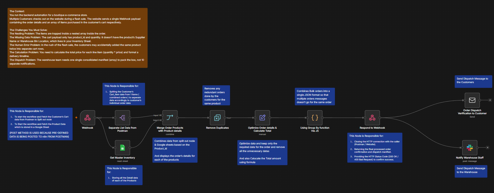

# Scenario 7.2: Flash-Sale Multi-Order Batch Dispatch Engine

An enterprise-grade batch fulfillment pipeline designed to ingest multiple customer orders within a single webhook payload, perform composite deduplication, enrich data with warehouse stock records, dynamically group items by order using custom JavaScript, and trigger automated downstream actions (Slack & Email) per order.

---

## 🖼️ Workflow Architecture

---

## ⚡ Key Architectural Upgrades (vs. Single Order)

- **Batch Ingestion:** Handles large multi-order arrays (`body.order_lines`) in a single API call instead of separate requests.
- **Composite Key Deduplication:** Uses a multi-field rule (`['body.order_lines'].order_id` + `Product ID`) to prevent cross-customer data loss while eliminating cart misclicks.
- **Custom JS Grouping (Code Node):** Overcomes visual node limitations by grouping flat line items into distinct parent order objects, automatically computing `grand_total` and item counts.
- **Auto-Looping Actions:** Because the Code node outputs distinct order packages, downstream **Slack** and **Email** nodes automatically loop and execute once per customer order.
- **Fast Acknowledgment Pattern:** Returns the complete multi-order manifest to the caller (`200 OK`) before processing background dispatch alerts.

---

## ⚙️ Nodes Used

- **Webhook Node (POST):** Receives the multi-order batch payload.
- **Split Out Node:** Flattens the batch array into individual line items.
- **Google Sheets Node:** Reads product catalog data (Shelf locations, Suppliers, Prices).
- **Merge Node:** Combines cart items with catalog records via `Product ID`.
- **Remove Duplicates Node:** Evaluates composite keys (`order_id` + `product_id`) within the current input.
- **Edit Fields (Set) Node:** Formats clean schema and calculates item totals (`Qty × Price`).
- **Code Node (JavaScript):** Groups flat items into dedicated order envelopes and sums order grand totals.
- **Respond to Webhook Node:** Returns all processed order packages to the client.
- **Send an Email Node (SMTP):** Dispatches personalized receipts to each customer.
- **Slack Node:** Sends itemized picking manifests directly to warehouse channels.

---

## 🚀 How to Import

1. Download [`workflow.json`](./workflow.json).
2. In n8n: **`...`** ➔ **Import from File**.
3. Configure credentials:
   - Google Sheets OAuth2
   - Slack OAuth2 Bot Token
   - SMTP / Email account
4. Activate the Webhook and send a multi-order test payload via Postman!
