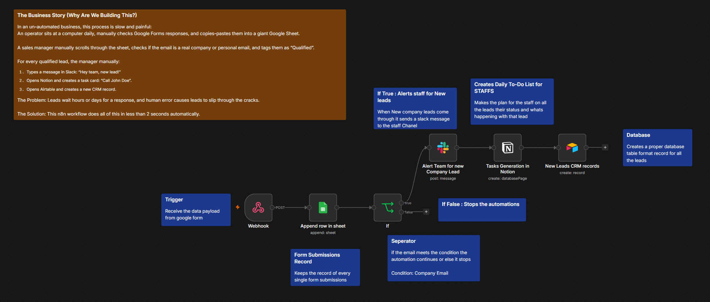

# Scenario 8: Multi-App Lead Management & Qualification Pipeline

An automated real-time lead triage engine that captures survey submissions from Google Forms, archives all entries in Google Sheets, filters qualified business leads via conditional logic, and orchestrates actions across **Slack**, **Notion**, and **Airtable CRM** in under 2 seconds.

---

## 🖼️ Workflow Architecture

---

## 🎯 The Business Problem

In high-volume marketing campaigns, sales teams face a critical speed-to-lead problem:
- Operators waste hours manually copying survey responses into spreadsheets.
- Sales managers manually inspect submissions to separate personal emails (`@gmail.com`) from legitimate corporate leads (`@company.com`).
- Manual delays in assigning tasks and updating CRM databases lead to cold leads and lost revenue.

This workflow eliminates all manual data entry, evaluating leads instantly upon form submission and dispatching notifications and tasks in parallel.

---

## 🔄 The Pipeline Flow

1. **Capture:** A prospect submits a Google Form survey (tunneled in real-time via Webhook).
2. **Archive:** Every submission is permanently logged into a master **Google Sheet** archive.
3. **Qualify (If Node):** Evaluates whether the lead provided a valid corporate company email.
   - **`False`:** Workflow safely ends (unqualified leads remain in the archive without cluttering sales boards).
   - **`True`:** Triggers the multi-app sales dispatch sequence.
4. **Instant Alert (Slack):** Posts a formatted alert with lead details to `#sales-notifications`.
5. **Actionable Task (Notion):** Generates a Kanban task card on the sales board for rep follow-up.
6. **CRM Record (Airtable):** Creates a structured customer record in the CRM pipeline.

---

## ⚙️ Nodes & Tools Used

- **Webhook Node (POST):** Receives real-time Google Form payload via Google Apps Script (`onFormSubmit`).
- **Google Sheets Node (`append: sheet`):** Central archive for all incoming raw survey leads.
- **If Node (Logic):** Filters leads based on company email validation.
- **Slack Node (`post: message`):** Dispatches real-time sales team alerts.
- **Notion Node (`create: databasePage`):** Creates follow-up task pages with context blocks.
- **Airtable Node (`create: record`):** Records structured lead entities in the CRM base.

---

## 🚀 How to Import

1. Download [`workflow.json`](./workflow.json).
2. In n8n: **`...`** ➔ **Import from File**.
3. Connect your credentials:
   - Google Sheets OAuth2
   - Slack Bot Token
   - Notion Internal Integration Token (PAT)
   - Airtable Personal Access Token (PAT)
4. Link your respective Sheet, Channel ID, Notion Database, and Airtable Base.
5. Submit a test response to your Google Form and watch all 4 platforms update simultaneously!
